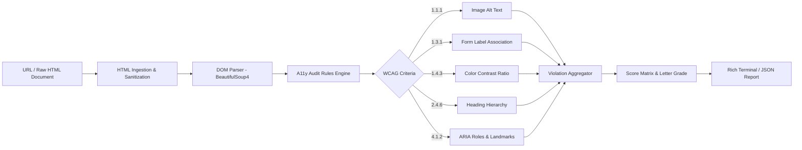

# A11y Sentinel: Automated WCAG 2.1 Accessibility Auditor

[](https://www.python.org/)
[](https://www.w3.org/WAI/WCAG21/quickref/)
[](https://pydantic.dev/)
[](https://opensource.org/licenses/MIT)
[](#)

An enterprise-grade, offline-capable accessibility auditing CLI engine that parses HTML DOM trees, audits them against **WCAG 2.1 Level AA** standards, generates composite accessibility health scores (0-100), and outputs automated code remediation patches.

Built on **BeautifulSoup4**, **Playwright**, **Pydantic v2**, and **Rich**.

---

## 🎯 Architecture & Data Flow



---

## 🔬 Working Model & CLI Execution Walkthrough

### Example Command
```bash
python -m src.main https://example.com --strict
```

### Live Working Model Output
```text
╭──────────────────────────────────────────────────────────────────────────────╮
│                       🛡️ A11y Sentinel v1.0.0                                │
│   Auditing Target: https://example.com (WCAG 2.1 Level AA)                   │
╰──────────────────────────────────────────────────────────────────────────────╯

Violations Detected:
┏━━━━━━━━━━┳━━━━━━━━━━━━━┳━━━━━━━━━━━━━━━━━━━━━━━━━━━┳━━━━━━━━━━━━━━━━━━━━━━━━━┓
┃ Rule ID  ┃ Severity    ┃ Element                   ┃ Description             ┃
┣━━━━━━━━━━╋━━━━━━━━━━━━━╋━━━━━━━━━━━━━━━━━━━━━━━━━━━╋━━━━━━━━━━━━━━━━━━━━━━━━━┫
┃ WCAG-1.1 ┃ HIGH        ┃      ┃ Missing alt attribute   ┃
┃ WCAG-1.3 ┃ MEDIUM      ┃ <input type="email">      ┃ Missing <label> or aria ┃
┃ WCAG-2.4 ┃ LOW         ┃ <h3>Subheader</h3>        ┃ H3 skipped H2 hierarchy ┃
┗━━━━━━━━━━┻━━━━━━━━━━━━━┻━━━━━━━━━━━━━━━━━━━━━━━━━━━┻━━━━━━━━━━━━━━━━━━━━━━━━━┛

┏━━━━━━━━━━━━━━━━━━━━━━━━━━━━━━━━━━━━━━━━━━━━━━━━━━━━━━━━━━━━━━━━━━━━━━━━━━━━━━┓
┃ Audit Summary Scorecard                                                      ┃
┣━━━━━━━━━━━━━━━━━━━━━━━━━━━━━━━━━━━━━━━━━━━━━━━━━━━━━━━━━━━━━━━━━━━━━━━━━━━━━━┫
┃ Overall Score : 82 / 100                                                     ┃
┃ Rating        : Grade B (Needs Attention)                                    ┃
┃ Violations    : 3 (1 High, 1 Medium, 1 Low)                                  ┃
┃ Action        : Generated remediation snippet saved to 'a11y_fix.diff'       ┃
┗━━━━━━━━━━━━━━━━━━━━━━━━━━━━━━━━━━━━━━━━━━━━━━━━━━━━━━━━━━━━━━━━━━━━━━━━━━━━━━┛
```

---

## ⚡ Core Features

- **Standardized Ruleset**: Directly maps rules to WCAG 2.1 Success Criteria (1.1.1 Non-text Content, 1.3.1 Info & Relationships, 1.4.3 Minimum Contrast, 2.4.1 Bypass Blocks).
- **Automated Remediation Generator**: Emits drop-in unified diffs (`.diff`) suggesting correct `aria-label`, semantic tags, and descriptive alt attributes.
- **Dual Mode Ingestion**: Audits live dynamic websites using Playwright headless execution, or offline static HTML strings for sub-second CI pipelines.
- **Pydantic Data Contracts**: Full JSON serialization of violation objects and audit metadata.
