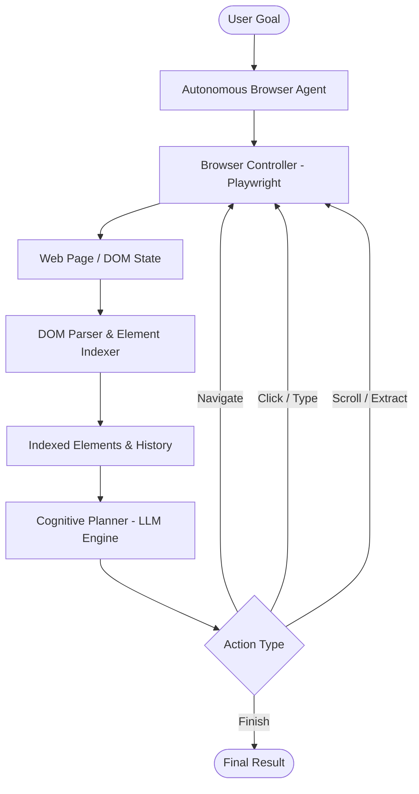

# Autonomous Web Agent

[](https://www.python.org/)
[](https://playwright.dev/)
[](https://pydantic.dev/)
[](https://opensource.org/licenses/MIT)
[](#)

An autonomous AI browser agent capable of perceiving web pages, decomposing high-level user goals, executing multi-step interactions (clicks, inputs, navigation, scrolls), and extracting structured data in real time.

Built on **Playwright**, **Pydantic v2**, and modern **LLM Reasoning Architectures**.

---

## 🎯 Architecture & Data Flow



---

## 🔬 Working Model & CLI Execution Walkthrough

### Example Command
```bash
python -m src.main --goal "Navigate to Hacker News, find the top AI post, and extract its title and URL" --headless
```

### Live Working Model Output
```text
╭──────────────────────────────────────────────────────────────────────────────╮
│                     🤖 Autonomous Web Agent v1.0.0                           │
│   Goal: Navigate to Hacker News, find top AI post, extract title & URL       │
╰──────────────────────────────────────────────────────────────────────────────╯
[14:22:01] INFO     Initializing Chromium browser context (viewport: 1280x800)...
[14:22:02] ACTION   [Step 1] Navigate to https://news.ycombinator.com
[14:22:03] PERCEIVE Indexed 60 interactive links and 30 story items.
[14:22:03] PLAN     Analyzing story titles for semantic match with 'AI' / 'LLM'...
[14:22:04] MATCH    Identified Rank #3: 'Open-weights Reasoning Model Released' (ID: #link-3)
[14:22:04] ACTION   [Step 2] Extract attribute 'href' and inner text for element #link-3
[14:22:05] SUCCESS  Target goal achieved in 2 steps (elapsed time: 3.42s).

┏━━━━━━━━━━━━━━━━━━━━━━━━━━━━━━━━━━━━━━━━━━━━━━━━━━━━━━━━━━━━━━━━━━━━━━━━━━━━━━┓
┃ Extracted Structured Result                                                  ┃
┣━━━━━━━━━━━━━━━━━━━━━━━━━━━━━━━━━━━━━━━━━━━━━━━━━━━━━━━━━━━━━━━━━━━━━━━━━━━━━━┫
┃ Title : Open-weights Reasoning Model Released                                ┃
┃ URL   : https://arxiv.org/abs/2610.12345                                     ┃
┃ Points: 284 points by user_ml 4 hours ago                                   ┃
┗━━━━━━━━━━━━━━━━━━━━━━━━━━━━━━━━━━━━━━━━━━━━━━━━━━━━━━━━━━━━━━━━━━━━━━━━━━━━━━┛
```

---

## ⚡ Core Features

- **Goal-Driven Cognitive Loop**: Parses open-ended natural language prompts into sequential, stateful browser actions.
- **Deterministic DOM Indexing**: Eliminates brittle XPath selectors by indexing interactive nodes (`input`, `button`, `a`, `select`) with unique semantic numeric IDs.
- **Error Recovery & Backtracking**: Detects unexpected modals, popups, and broken navigations, automatically executing recovery fallbacks.
- **Pydantic Validation**: All agent plans, element states, and extracted results adhere to strict type-checked schemas.
