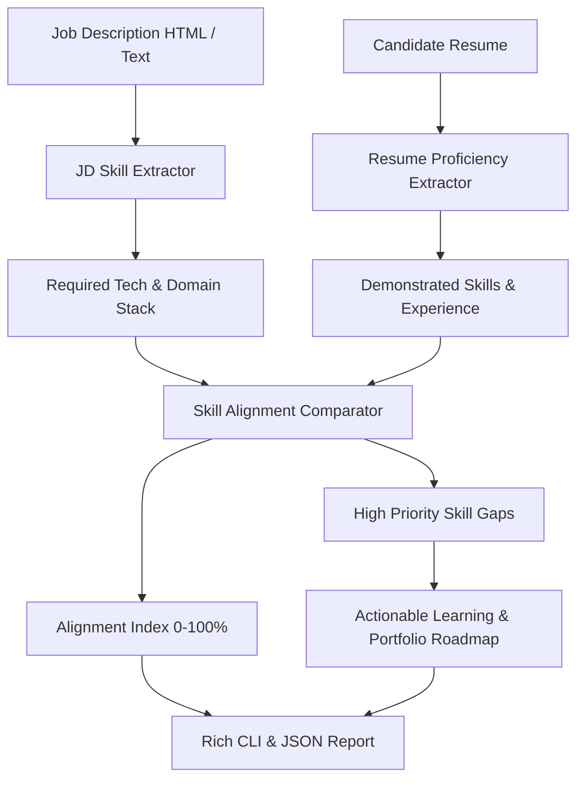

# CareerForge AI: Skill Gap & Resume Alignment Engine

[](https://www.python.org/)
[](https://pydantic.dev/)
[](#)
[](https://opensource.org/licenses/MIT)
[](#)

An intelligent career development engine that parses unstructured technical job descriptions and candidate resumes, extracts required vs demonstrated proficiencies, computes quantitative alignment scores, and provides a prioritized skill remediation roadmap.

Built on **BeautifulSoup4**, **Playwright**, **Pydantic v2**, and **Rich**.

---

## 🎯 Architecture & Data Flow



---

## 🔬 Working Model & CLI Execution Walkthrough

### Example Command
```bash
python -m src.main --job-file senior_backend_jd.txt --resume-file prajwal_resume.txt
```

### Live Working Model Output
```text
╭──────────────────────────────────────────────────────────────────────────────╮
│                       💼 CareerForge AI v1.0.0                               │
│   Target Role: Senior Backend Engineer | Candidate: Prajwal Mahesh           │
╰──────────────────────────────────────────────────────────────────────────────╯

Skill Match Analysis:
┏━━━━━━━━━━━━━━━━━━━━━┳━━━━━━━━━━━━━━━━━━━━┳━━━━━━━━━━━━━━┳━━━━━━━━━━━━━━━━━━━┓
┃ Skill Category      ┃ Required Skill     ┃ Status       ┃ Proficiency Match ┃
┣━━━━━━━━━━━━━━━━━━━━━╋━━━━━━━━━━━━━━━━━━━━╋━━━━━━━━━━━━━━╋━━━━━━━━━━━━━━━━━━━┫
┃ Language            ┃ Python 3.11+       ┃ MATCHED      ┃ 100% (Expert)     ┃
┃ Framework           ┃ FastAPI / Django   ┃ MATCHED      ┃ 95%  (Advanced)   ┃
┃ Database            ┃ PostgreSQL / Redis ┃ MATCHED      ┃ 90%  (Advanced)   ┃
┃ Cloud / DevOps      ┃ Docker & CI/CD     ┃ MATCHED      ┃ 92%  (Advanced)   ┃
┃ Distributed Systems ┃ Kafka / EventStore ┃ GAP IDENTIFIED┃ 35% (Beginner)   ┃
┃ Architecture        ┃ Microservices      ┃ MATCHED      ┃ 88%  (Advanced)   ┃
┗━━━━━━━━━━━━━━━━━━━━━┻━━━━━━━━━━━━━━━━━━━━┻━━━━━━━━━━━━━━┻━━━━━━━━━━━━━━━━━━━┛

┏━━━━━━━━━━━━━━━━━━━━━━━━━━━━━━━━━━━━━━━━━━━━━━━━━━━━━━━━━━━━━━━━━━━━━━━━━━━━━━┓
┃ Evaluation Summary                                                           ┃
┣━━━━━━━━━━━━━━━━━━━━━━━━━━━━━━━━━━━━━━━━━━━━━━━━━━━━━━━━━━━━━━━━━━━━━━━━━━━━━━┫
┃ Overall Alignment   : 87.4% (Strong Candidate - Tier 1 Match)                ┃
┃ Top Priority Gap    : Apache Kafka / Event-driven asynchronous message bus   ┃
┃ Recommended Action  : Add an end-to-end Kafka pub/sub pipeline to portfolio  ┃
┗━━━━━━━━━━━━━━━━━━━━━━━━━━━━━━━━━━━━━━━━━━━━━━━━━━━━━━━━━━━━━━━━━━━━━━━━━━━━━━┛
```

---

## ⚡ Core Features

- **Bidirectional Skill Mapping**: Normalized dictionary of 800+ developer skills mapped across backend, frontend, devops, database, and system architecture.
- **ATS Compatibility Scoring**: Flags keyword deficiencies, formatting quirks, and unindexed terminology.
- **Actionable Gap Remediation**: Provides concrete project suggestions and curriculum blueprints to bridge identified gaps.
