# CleanDOM Crawler: Semantic Scraper & RAG Chunking Engine

[](https://www.python.org/)
[](https://www.crummy.com/software/BeautifulSoup/)
[](#)
[](https://opensource.org/licenses/MIT)
[](#)

A high-throughput semantic web scraping and clean markdown conversion engine specifically tuned for LLM fine-tuning and RAG vector search pipelines. CleanDOM strips boilerplate, navigational cruft, ads, and tracking tags while preserving code fences, mathematical formulas, and hierarchical heading trees.

Built on **BeautifulSoup4**, **Pydantic v2**, **Playwright**, and **Rich**.

---

## 🎯 Architecture & Data Flow

```mermaid
flowchart LR
    RawHTML[Raw Web Page / DOM] --> Sanitizer[Noise & Cruft Stripper]
    Sanitizer --> NoiseFilter[Remove: nav, footer, script, iframe, cookie]
    NoiseFilter --> ContentExtractor[Semantic Article & Main Extractor]
    ContentExtractor --> MarkdownConverter[Structure-Preserving Markdown Converter]
    MarkdownConverter --> Chunker[Token-Bounded Semantic Chunker]
    Chunker --> EmbeddingsReady[Overlapping Chunks + Metadata Dossier]
```



---

## 🔬 Working Model & CLI Execution Walkthrough

### Example Command
```bash
python -m src.main https://docs.example.com/deep-dive --max-tokens 400 --overlap 50
```

### Live Working Model Output
```text
╭──────────────────────────────────────────────────────────────────────────────╮
│                       🧹 CleanDOM Crawler v1.0.0                             │
│   Target: https://docs.example.com/deep-dive | Max Tokens/Chunk: 400         │
╰──────────────────────────────────────────────────────────────────────────────╯
[18:30:01] INGEST   Fetched 142 KB raw HTML document.
[18:30:02] CLEAN    Stripped 84% boilerplate (navbars, ads, scripts, footer).
[18:30:02] PARSE    Extracted 2,140 tokens of pure semantic prose & code blocks.
[18:30:03] CHUNK    Generated 6 semantic chunks with 50-token contextual overlap.

Chunk Inspection (Chunk #1 of 6):
┏━━━━━━━━━━━━━━━━━━━━━━━━━━━━━━━━━━━━━━━━━━━━━━━━━━━━━━━━━━━━━━━━━━━━━━━━━━━━━━┓
┃ Header   : # Architectural Foundations > Memory Virtualization               ┃
┃ Tokens   : 382 tokens | Characters: 1,490                                    ┃
┃ Snippet  :                                                                   ┃
┃   "Memory virtualization abstracts physical RAM into contiguous virtual      ┃
┃    address spaces. The MMU relies on multi-level page tables..."             ┃
┃ Metadata : { source: "https://docs.example.com/deep-dive", index: 1 }       ┃
┗━━━━━━━━━━━━━━━━━━━━━━━━━━━━━━━━━━━━━━━━━━━━━━━━━━━━━━━━━━━━━━━━━━━━━━━━━━━━━━┛
Output serialized to `clean_rag_payload.json` (Tokens saved vs Raw HTML: 91.2%).
```

---

## ⚡ Core Features

- **Boilerplate Suppression**: Heuristics filter out navigational banners, GDPR cookie dialogs, social share buttons, and disclaimers.
- **Code Block & Math Preservation**: Detects `pre > code` and LaTeX KaTeX/MathJax expressions, preserving whitespace and syntax.
- **Token-Aware Windowing**: Chunks documents cleanly along paragraph and sentence boundaries without slicing words or tokens mid-stride.
