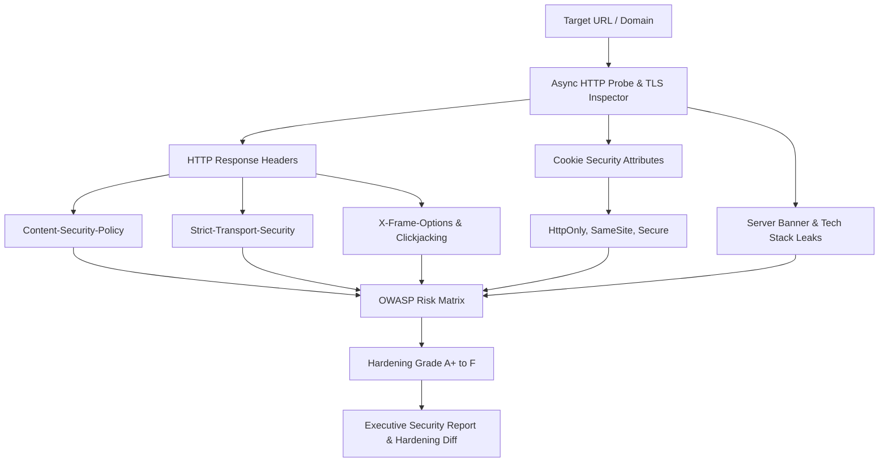

# CyberProbe AI: Web Security Attack Surface & Header Auditor

[](https://www.python.org/)
[](https://owasp.org/)
[](https://pydantic.dev/)
[](https://opensource.org/licenses/MIT)
[](#)

An automated web security attack surface scanner and HTTP security header auditor. CyberProbe analyzes live HTTP/S response headers, cookie flags, TLS protocol parameters, and information disclosure leaks to grade web server hardening from A+ down to F, accompanied by actionable remediation directives.

Built on **Playwright**, **Pydantic v2**, **BeautifulSoup4**, and **Rich**.

---

## 🎯 Architecture & Data Flow



---

## 🔬 Working Model & CLI Execution Walkthrough

### Example Command
```bash
python -m src.main https://insecure-portal.example.com --strict
```

### Live Working Model Output
```text
╭──────────────────────────────────────────────────────────────────────────────╮
│                       🔒 CyberProbe AI v1.0.0                                │
│   Auditing Target: https://insecure-portal.example.com                       │
╰──────────────────────────────────────────────────────────────────────────────╯

Security Header & Policy Audit:
┏━━━━━━━━━━━━━━━━━━━━━━━━━━━━┳━━━━━━━━━━━━┳━━━━━━━━━━┳━━━━━━━━━━━━━━━━━━━━━━━━━┓
┃ Header Name                ┃ Status     ┃ Severity ┃ Risk Implication        ┃
┣━━━━━━━━━━━━━━━━━━━━━━━━━━━━╋━━━━━━━━━━━━╋━━━━━━━━━━╋━━━━━━━━━━━━━━━━━━━━━━━━━┫
┃ Content-Security-Policy    ┃ MISSING    ┃ HIGH     ┃ Vulnerable to XSS / SRI ┃
┃ Strict-Transport-Security  ┃ PARTIAL    ┃ MEDIUM   ┃ Missing includeSubDomains┃
┃ X-Frame-Options            ┃ CONFIGURED ┃ PASS     ┃ Protected (DENY)        ┃
┃ X-Content-Type-Options     ┃ MISSING    ┃ LOW      ┃ MIME-sniffing possible  ┃
┃ Cookie: session_token      ┃ FLAWED     ┃ HIGH     ┃ Missing 'HttpOnly' flag ┃
┃ Server Header              ┃ DISCLOSED  ┃ LOW      ┃ Leaks: 'nginx/1.18.0'   ┃
┗━━━━━━━━━━━━━━━━━━━━━━━━━━━━┻━━━━━━━━━━━━┻━━━━━━━━━━┻━━━━━━━━━━━━━━━━━━━━━━━━━┛

┏━━━━━━━━━━━━━━━━━━━━━━━━━━━━━━━━━━━━━━━━━━━━━━━━━━━━━━━━━━━━━━━━━━━━━━━━━━━━━━┓
┃ Security Audit Scorecard                                                     ┃
┣━━━━━━━━━━━━━━━━━━━━━━━━━━━━━━━━━━━━━━━━━━━━━━━━━━━━━━━━━━━━━━━━━━━━━━━━━━━━━━┫
┃ Hardening Score : 54 / 100                                                   ┃
┃ Letter Grade    : Grade D (Immediate Remediation Recommended)                ┃
┃ Recommended Nginx Header Configuration snippet generated in 'security.conf'  ┃
┗━━━━━━━━━━━━━━━━━━━━━━━━━━━━━━━━━━━━━━━━━━━━━━━━━━━━━━━━━━━━━━━━━━━━━━━━━━━━━━┛
```

---

## ⚡ Core Features

- **OWASP Compliance Mapping**: Evaluates security posture against OWASP Secure Headers guidelines.
- **Cookie Rigor Validation**: Checks `Secure`, `HttpOnly`, and `SameSite` flags across all session cookies.
- **Server Hardening Snippet Generator**: Automatically outputs ready-to-paste Nginx, Apache, or Caddy configuration snippets to achieve an A+ rating.
