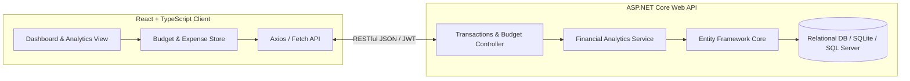

# FinTrack: Full-Stack Personal Finance & Telemetry Platform

[](https://www.typescriptlang.org/)
[](https://vitejs.dev/)
[](https://dotnet.microsoft.com/)
[](https://opensource.org/licenses/MIT)
[](#)

A high-performance full-stack personal finance management and daily ledger telemetry platform. FinTrack provides unified budget forecasting, category spend analysis, net cash flow tracking, and automated audit logs.

Built with **React 18**, **TypeScript**, **Vite**, and **ASP.NET Core Web API**.

---

## 🎯 Architecture & Data Flow



---

## 🔬 Working Model & Dashboard Telemetry

### Financial Ledger Telemetry Snapshot
```text
┏━━━━━━━━━━━━━━━━━━━━━━━━━━━━━━━━━━━━━━━━━━━━━━━━━━━━━━━━━━━━━━━━━━━━━━━━━━━━━━┓
┃                     💳 FinTrack Financial Overview                           ┃
┣━━━━━━━━━━━━━━━━━━━━━━━━━━━━━━━━━━━━━━━━━━━━━━━━━━━━━━━━━━━━━━━━━━━━━━━━━━━━━━┫
┃ Total Monthly Inflow   : $ 6,450.00                                          ┃
┃ Total Monthly Outflow  : $ 3,120.40                                          ┃
┃ Net Cash Savings       : $ 3,329.60 (51.6% Savings Rate)                     ┃
┃ Burn Rate Status       : Optimal (38.2 days runway per liquid reserve)       ┃
┗━━━━━━━━━━━━━━━━━━━━━━━━━━━━━━━━━━━━━━━━━━━━━━━━━━━━━━━━━━━━━━━━━━━━━━━━━━━━━━┛

Category Breakdown:
  Housing & Utilities  │ ████████████████████░░░░░░░░░░  $ 1,450.00  (46.5%)
  Investments & Equity │ ██████████░░░░░░░░░░░░░░░░░░░░  $   800.00  (25.6%)
  Groceries & Dining   │ ██████░░░░░░░░░░░░░░░░░░░░░░░░  $   480.20  (15.4%)
  Transport & Mobility │ ███░░░░░░░░░░░░░░░░░░░░░░░░░░░  $   210.20  ( 6.7%)
  Leisure & Subs       │ ██░░░░░░░░░░░░░░░░░░░░░░░░░░░░  $   180.00  ( 5.8%)
```

---

## ⚡ Core Features

- **Automated Expense Classification**: Real-time transaction ingestion with automatic tag allocation and multi-currency support.
- **Runway & Savings Velocity**: Calculates liquidity ratios, burn rate, and projected monthly runway based on rolling trailing averages.
- **RESTful C# API Architecture**: Strict separation of concerns using ASP.NET Core controllers, DTO validation, and EF Core migration workflows.
- **Telemetry & Activity Ledger**: Automated auditing ledger recording balance changes, schema revisions, and benchmark timings.
