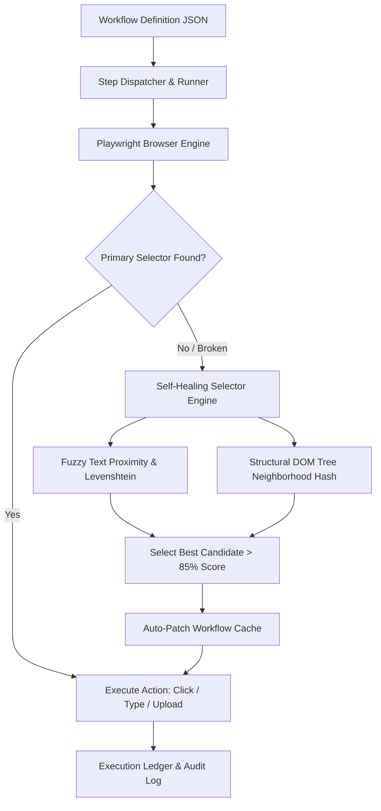

# FlowRPA Core: Enterprise Browser RPA & Self-Healing Engine

[](https://www.python.org/)
[](https://playwright.dev/)
[](https://pydantic.dev/)
[](https://opensource.org/licenses/MIT)
[](#)

An enterprise robotic process automation (RPA) workflow execution engine equipped with intelligent, self-healing selectors. When website redesigns break conventional IDs or CSS selectors, FlowRPA analyzes DOM neighborhoods, text proximity, and structural Levenshtein distances to dynamically relocate target elements without human intervention.

Built on **Playwright**, **Pydantic v2**, **BeautifulSoup4**, and **Rich**.

---

## 🎯 Architecture & Data Flow



---

## 🔬 Working Model & CLI Execution Walkthrough

### Example Command
```bash
python -m src.main --workflow enterprise_invoice_flow.json
```

### Live Working Model Output
```text
╭──────────────────────────────────────────────────────────────────────────────╮
│                       ⚡ FlowRPA Core v1.0.0                                 │
│   Executing Workflow: enterprise_invoice_flow.json (5 total steps)           │
╰──────────────────────────────────────────────────────────────────────────────╯
[17:11:01] STEP 1   Navigate to https://portal.internal.corp/invoicing ... [OK]
[17:11:02] STEP 2   Fill input `#username-field` with 'finance_agent' ... [OK]
[17:11:03] STEP 3   Locate submit button `#btn-submit-v2` ...
[17:11:04] WARNING  Primary selector `#btn-submit-v2` NOT FOUND (UI altered!).
[17:11:04] HEAL     Invoking Self-Healing Selector Engine...
                    - Candidates analyzed : 8 interactive elements
                    - Match candidate     : `<button class="primary-action">Submit Invoice</button>`
                    - Confidence score    : 96.2% (Text match + Form ancestry)
[17:11:05] HEAL     Auto-healed step selector to `//button[contains(.,'Submit Invoice')]`
[17:11:05] STEP 4   Click healed button ... [OK]
[17:11:06] STEP 5   Extract transaction confirmation ID ... [OK: 'INV-902381']

Workflow Execution Completed: 5 / 5 Steps Succeeded (1 Step Self-Healed).
```

---

## ⚡ Core Features

- **Zero-Downtime Resilience**: Self-healing algorithms prevent broken automation runs when frontend developers rename classes or reorder elements.
- **Workflow State Checkpointing**: Supports step retry mechanisms, exponential backoffs, and deterministic rollbacks.
- **Structured Audit Trails**: Generates step-by-step screenshots and JSON trace ledgers for enterprise compliance.
