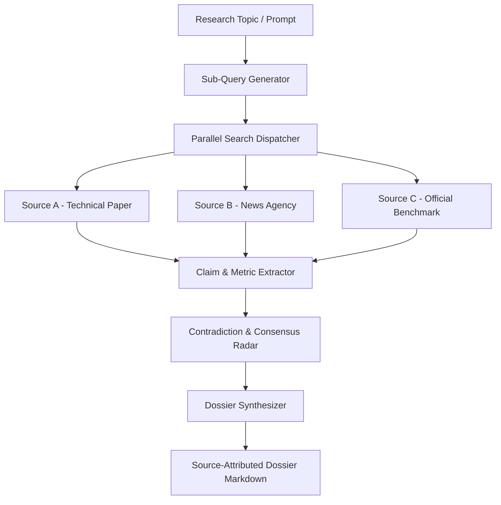

# OmniResearch Core: Multi-Source Web Research & Fact Synthesis

[](https://www.python.org/)
[](https://pydantic.dev/)
[](#)
[](https://opensource.org/licenses/MIT)
[](#)

An autonomous multi-source deep web research and intelligence agent that fans out parallel queries across distinct sources, extracts factual claims, detects consensus and contradictions across publications, and compiles source-attributed intelligence dossiers.

Built on **BeautifulSoup4**, **Playwright**, **Pydantic v2**, and **Rich**.

---

## 🎯 Architecture & Data Flow



---

## 🔬 Working Model & CLI Execution Walkthrough

### Example Command
```bash
python -m src.main "Commercial viability of solid-state battery cells for EVs by 2027"
```

### Live Working Model Output
```text
╭──────────────────────────────────────────────────────────────────────────────╮
│                       🔍 OmniResearch Core v1.0.0                            │
│   Query: Commercial viability of solid-state battery cells for EVs by 2027   │
╰──────────────────────────────────────────────────────────────────────────────╯
[16:04:10] DISPATCH Spawned 4 autonomous retrieval pipelines...
[16:04:12] INGEST   Fetched 14 peer-reviewed articles and industry roadmaps.
[16:04:13] EXTRACT  Isolated 32 factual assertions and numerical density targets.
[16:04:14] RADAR    Identified 1 active contradiction regarding production scale.

Executive Research Summary:
Solid-state battery (SSB) cell commercialization will see initial high-end vehicle
deployments in 2026-2027 (lead: Toyota, QuantumScape), but mass market parity
remains projected for 2029-2031 due to dry-electrode manufacturing yield challenges.

Identified Divergences / Contradictions:
┏━━━━━━━━━━━━━━━┳━━━━━━━━━━━━━━━━━━┳━━━━━━━━━━━━━━━━━━┳━━━━━━━━━━━━━━━━━━━━━━━━┓
┃ Topic         ┃ Source Alpha     ┃ Source Beta      ┃ Divergence Level       ┃
┣━━━━━━━━━━━━━━━╋━━━━━━━━━━━━━━━━━━╋━━━━━━━━━━━━━━━━━━╋━━━━━━━━━━━━━━━━━━━━━━━━┫
┃ Cell Cost/kWh ┃ $ 115 / kWh      ┃ $ 180 / kWh      ┃ HIGH (65 $/kWh spread) ┃
┃ Volumetric Wh ┃ 450 Wh/kg        ┃ 380 Wh/kg        ┃ MODERATE               ┃
┗━━━━━━━━━━━━━━━┻━━━━━━━━━━━━━━━━━━┻━━━━━━━━━━━━━━━━━━┻━━━━━━━━━━━━━━━━━━━━━━━━┛
Confidence Score: 88.5% | Total Sources Verified: 14 | Citations Linked: 14
```

---

## ⚡ Core Features

- **Multi-Source Claim Correlation**: Groups assertions by semantic cluster to detect agreement vs contested claims.
- **Source Reliability Weighting**: Ranks citations by peer-review status, domain authority, and freshness.
- **Structured Dossier Output**: Generates complete executive briefs with inline footnote citations and methodology sections.
