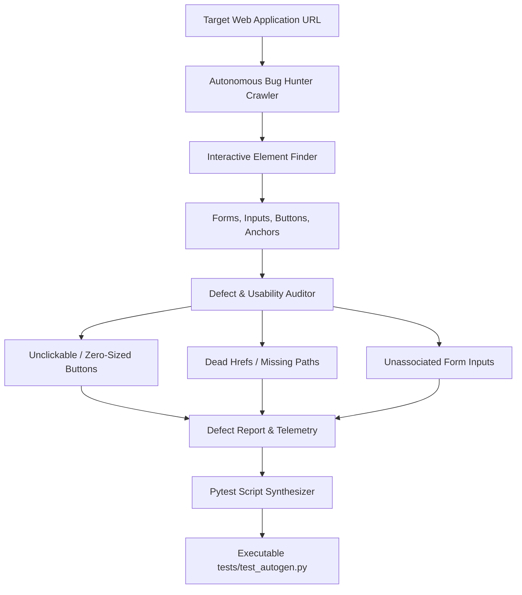

# UITest Forge: Web UI Bug Hunter & Pytest Synthesizer

[](https://www.python.org/)
[](https://playwright.dev/)
[](https://pytest.org/)
[](https://opensource.org/licenses/MIT)
[](#)

An autonomous QA exploration agent and test synthesis engine that crawls web user interfaces, inspects input forms and interactive elements, detects client-side defects (broken event handlers, unlabelled controls, inaccessible buttons), and synthesizes production-ready, standalone Pytest test scripts.

Built on **Playwright**, **Pydantic v2**, **BeautifulSoup4**, and **Rich**.

---

## 🎯 Architecture & Data Flow



---

## 🔬 Working Model & CLI Execution Walkthrough

### Example Command
```bash
python -m src.main https://portal.example.com --generate-test tests/test_portal.py
```

### Live Working Model Output
```text
╭──────────────────────────────────────────────────────────────────────────────╮
│                       🛠️ UITest Forge v1.0.0                                 │
│   Target: https://portal.example.com | Synthesis Mode: Pytest Playwright     │
╰──────────────────────────────────────────────────────────────────────────────╯
[19:10:01] CRAWL    Indexed 48 interactive components (12 inputs, 8 buttons, 28 links).
[19:10:02] AUDIT    Detected 2 UI usability defects.
                    - [DEFECT-01] `<button id="reset-btn">` has 0x0 clickable area.
                    - [DEFECT-02] `<input id="org-code">` lacks associated `<label>`.
[19:10:03] SYNTH    Generating executable test cases for happy path and edge flows...

Generated Pytest Script Preview (`tests/test_portal.py`):
```python
import pytest
from playwright.sync_api import Page, expect

def test_portal_elements_functional(page: Page):
    page.goto("https://portal.example.com")
    
    # Verify primary input is visible and editable
    org_input = page.locator("#org-code")
    expect(org_input).to_be_visible()
    org_input.fill("CORP-9981")
    
    # Assert primary action executes without console exceptions
    submit_btn = page.locator("button[type='submit']")
    expect(submit_btn).to_be_enabled()
    submit_btn.click()
```

Synthesized 4 test cases into `tests/test_portal.py` (Ready for CI run).
```

---

## ⚡ Core Features

- **Autonomous Interactive Discovery**: Discovers all actionable components without manual element locator recording.
- **Defect Classification**: Categorizes UI anomalies into accessibility, functional clickability, and DOM layout regressions.
- **Zero-Dependency Pytest Generation**: Synthesizes clean, PEP-8 compliant Python test scripts that can be plugged immediately into any existing CI/CD test runner.
